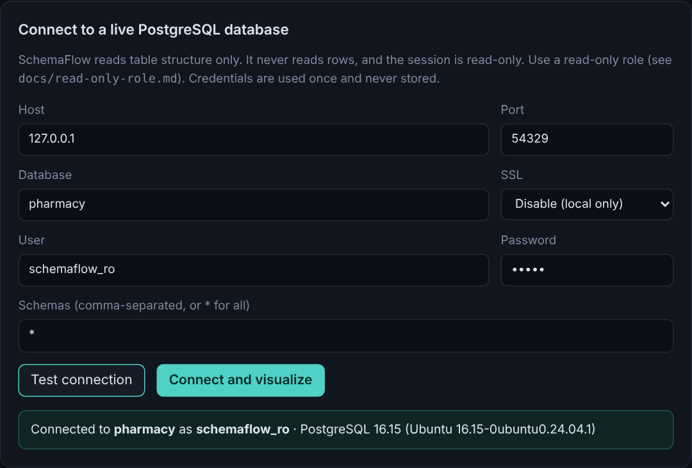
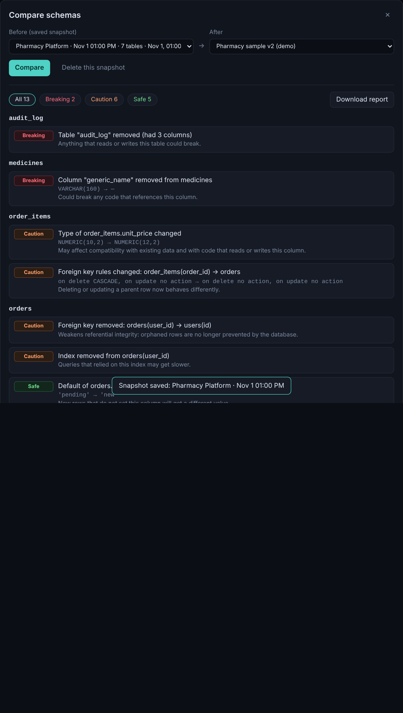

# SchemaFlow

Database schema visualization and exploration for developers. Import a SQL schema, see tables and relationships as an interactive diagram, inspect columns, search, and export docs.

## Screenshots

**Interactive diagram.** Click a table to highlight what it connects to and inspect its columns, keys and indexes.


**Live PostgreSQL connection.** Read-only, structure only. Credentials are used once and never stored.



**Schema comparison.** Save a snapshot, change your database, and see every change labelled Breaking, Caution or Safe.



## Quick start

```bash
npm install          # installs both workspaces
npm run dev:backend  # API on :4000
npm run dev:frontend # app on :5173 (proxies /api to the backend)
```

Open http://localhost:5173 and click **Try the pharmacy sample**, or upload a `.sql` file
(`pg_dump --schema-only` / `mysqldump --no-data` output works well).

```bash
npm test             # backend tests (parser, API, connection security)
npm run build        # production build of both
```

## What V1 does

- Import a SQL schema (file upload or paste), PostgreSQL or MySQL syntax
- **Connect to a live PostgreSQL database** (read-only session, structure only). See `docs/read-only-role.md`
- Extracts tables, columns, types, nullability, defaults, primary/unique keys, foreign keys, indexes
- Interactive diagram: pan, zoom, drag, auto-layout, minimap, highlight a table's neighbours
- Search tables, columns and data types; list tables with no relationships
- Inspector: sortable/filterable columns, relationships in both directions, indexes
- Relationships are labelled **explicit** (a real foreign key) or **inferred** (guessed from names like `user_id`, dashed and marked "confirm"). Toggle inferred ones off.
- Likely junction tables are flagged
- **Snapshots and comparison**: save the schema, change your database, then compare. Every change is labelled Breaking, Caution or Safe with a plain-English impact, and you can download the report. Try it with `samples/pharmacy.sql` vs `samples/pharmacy.v2.sql`
- Layouts and recent projects are saved in the browser (localStorage)
- Export: PNG, JSON, Markdown report

## Testing against a real PostgreSQL

The live-connection tests are skipped unless you point them at a database containing `samples/pharmacy.sql`:

```bash
# PowerShell
$env:SCHEMAFLOW_TEST_PG="localhost:5432:pharmacy:postgres:yourpassword"; npm test
# macOS / Linux
SCHEMAFLOW_TEST_PG="localhost:5432:pharmacy:postgres:yourpassword" npm test
```

## Layout

```
backend/src/
  routes/               HTTP endpoints (/api/import/sql, /api/export/markdown)
  services/importers/   SQL -> common SchemaModel (node-sql-parser, no regex parsing)
  services/introspection/ live PostgreSQL reader, host guard (SSRF), friendly errors
  services/schemaBuilder.ts  shared finishing step for every source
  services/comparison/  schema diff engine with risk labels
  services/exporters/   SchemaModel -> Markdown
  validators/           input checks
  types/schema.ts       the common schema model
frontend/src/
  features/schema-diagram, table-explorer, connections, schema-comparison, search
  services/             API client + localStorage
  pages/Workspace.tsx
samples/pharmacy.sql
```

`backend/src/types/schema.ts` is copied to `frontend/src/types/schema.ts`. Keep them in sync (or move to a shared workspace package later).

## Security notes

- Uploads capped at 2 MB, in memory only; nothing is written to disk or stored server-side
- Live connections: read-only transaction, timeouts, credentials used once and never stored, logged or returned
- Host guard blocks cloud-metadata and (in production) private/loopback targets, checks every resolved address, and connects to the validated IP to defeat DNS rebinding. Optional host and port allowlists
- Connection endpoints are rate limited and never cached
- Error messages are mapped to friendly text and never echo driver output or credentials
- Details and deployment settings: `docs/read-only-role.md`

## Next milestones

1. MySQL live introspection
2. Authentication, so it can be deployed publicly
3. Compare against a live database directly, and snapshot history per project
